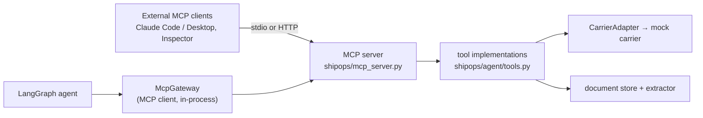

# MCP server

The shipping tools are exposed as an [MCP](https://modelcontextprotocol.io) server built
with the official Python SDK (`mcp` v2, `MCPServer`). The project's own agent uses it too:
every tool call from the LangGraph agent goes through an MCP client session (in-process),
so the server is the single tool boundary for the app and for external clients.



## Tools

| Tool | What it does | Side effects |
|---|---|---|
| `track_shipment` | Status, location, ETA, events for a tracking number or order number | read-only |
| `get_rates` | Quotes for a route/parcel + recommended service with reasons | read-only |
| `validate_address` | Carrier address check with issues and suggestions | read-only |
| `create_shipment` | Books a shipment and buys a label | **irreversible**, gated (below) |
| `extract_shipping_document` | Extracts invoice / bill-of-lading fields and flags problems (ids of uploaded docs, or a PDF as base64) | stores the uploaded PDF in memory |
| `get_order` | Store order lookup (customer, address, package) | read-only |
| `draft_customer_email` | Customer email draft grounded in live tracking data | read-only (drafts only) |

All tools return structured JSON with an `ok` flag; failures carry an `error` code and
`guidance` (e.g. "do not guess the status") instead of exceptions.

## How `create_shipment` is gated

Booking requires an explicit human "yes", enforced by the **server** through MCP
elicitation, not by trusting the calling model:

1. `create_shipment(..., dry_run=true)` returns a priced preview and a 12-character
   `confirmation_code`. Nothing is booked, and no elicitation is needed.
2. `create_shipment(...)` (no dry run) makes the server ask the **user**, via the client's
   elicitation UI, with a summary: recipient, package, service, price, and
   `Confirmation code: …`. It books only if the answer is *accept* with `confirm: true`,
   and only if the request is still exactly the one that was shown.
3. *Decline* or *cancel* means nothing is booked (`error: user_declined`).
4. **A client that does not support elicitation cannot book at all** (fail closed). The
   confirmation is resolved server-side and is not a tool argument, so a client or model
   can't forge it. Passing a `confirmation` field is ignored.

Inside the app, the agent's MCP client answers elicitation **only** for a confirmation code
that the human approved in the UI (the LangGraph `interrupt()` step). Any other booking
attempt is declined and logged. Tests: `tests/test_mcp_server.py`.

## Run the server

```bash
# stdio (what desktop/CLI clients launch)
uv run python -m shipops.mcp_server

# Streamable HTTP (remote clients), served at http://127.0.0.1:8002/mcp
uv run python -m shipops.mcp_server --transport streamable-http --port 8002
```

Configuration comes from the same environment / `.env` as the API:

- `CARRIER=mock` and `MOCK_CARRIER_URL=http://127.0.0.1:8001` use a running mock carrier.
  `MOCK_CARRIER_URL=inprocess` runs the mock carrier inside the MCP server process, so
  there's nothing else to start.
- `GEMINI_API_KEY` enables LLM/vision document extraction; without it the rule-based
  parser is used (scanned PDFs can't be read).

## Connect a client

### Claude Code

```bash
# stdio: Claude Code launches the server itself
claude mcp add shipment-ops -e MOCK_CARRIER_URL=inprocess \
  -- uv --directory /absolute/path/to/shipment-ops-agent run python -m shipops.mcp_server

# or connect to a running Streamable HTTP server
claude mcp add --transport http shipment-ops http://127.0.0.1:8002/mcp
```

Then ask, for example, "track order 4518" or "book order 4550 with standard". If the
client supports MCP elicitation, the booking question appears before anything is booked;
if it doesn't, the server refuses to book and the client can still preview with `dry_run`.

### Claude Desktop (or any client using an `mcpServers` JSON config)

```json
{
  "mcpServers": {
    "shipment-ops": {
      "command": "uv",
      "args": ["--directory", "/absolute/path/to/shipment-ops-agent",
               "run", "python", "-m", "shipops.mcp_server"],
      "env": { "MOCK_CARRIER_URL": "inprocess" }
    }
  }
}
```

Booking needs a client with elicitation support. Read-only tools and `dry_run` previews
work with any client.

### MCP Inspector (debugging)

```bash
npx @modelcontextprotocol/inspector uv run python -m shipops.mcp_server
```

### From Python

```python
import asyncio
from mcp import Client, StdioServerParameters

params = StdioServerParameters(
    command="uv",
    args=["run", "python", "-m", "shipops.mcp_server"],
    env={"MOCK_CARRIER_URL": "inprocess"},
)


async def main():
    async with Client(params) as client:
        result = await client.call_tool("track_shipment", {"order_id": "4518"})
        print(result.structured_content["status"])  # customs_hold


asyncio.run(main())
```

## Notes

- The server process keeps uploaded documents and created mock shipments in memory.
- Over Streamable HTTP the server has **no authentication**. Run it on localhost or behind
  your own auth; don't expose it publicly. The public demo API doesn't mount it.
- Tool names differ slightly from the agent's LLM-facing names (`get_rates` ↔
  `compare_rates`, `extract_shipping_document` ↔ `analyze_documents`). The agent-facing
  schemas were kept unchanged, so the recorded evals replay byte-for-byte through MCP.
